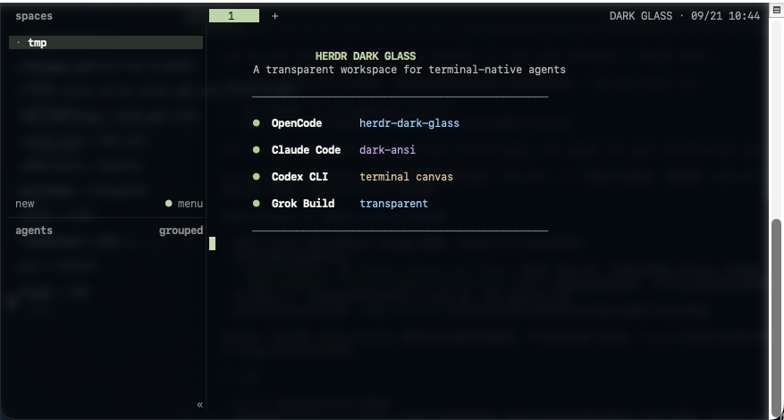

# Herdr Dark Glass

面向 macOS Terminal、Herdr 与终端 AI 工具的深色透明工作区。
A dark, transparent workspace for macOS Terminal, Herdr, and terminal-native AI tools.

## 效果呈现 / Preview

Terminal owns `#080E14` opacity and native blur (`0.24`): Glass `46%`, Clear `60%`, Read `74%`, Focus `88%`. Read 是默认启动级别。
Terminal owns the canvas: Glass `46%`, Clear `60%`, Read `74%`, and Focus `88%` opacity; Read is the default launch level.



## 安装与使用 / Install & Use

### 环境 / Requirements

- macOS、Terminal，以及 Herdr 0.8.2 或更高版本。/ macOS, Terminal, and Herdr 0.8.2 or newer.
- OpenCode、Claude Code、Codex CLI 和 Grok Build 均为可选项。/ OpenCode, Claude Code, Codex CLI, and Grok Build are optional.

### 安装并启用 / Install and enable

```bash
herdr plugin install neverendingstory/herdr-dark-glass
herdr plugin action invoke setup-dark-glass --plugin linyu.social-glass
herdr plugin action invoke apply-dark-glass --plugin linyu.social-glass
herdr plugin action invoke apply-dark-glass-themes --plugin linyu.social-glass
herdr plugin action invoke apply-dark-glass-grok --plugin linyu.social-glass
herdr plugin action invoke status --plugin linyu.social-glass
herdr plugin action invoke open-dark-glass-window --plugin linyu.social-glass
```

`setup-dark-glass` installs the OpenCode and Claude Code theme assets and visibly imports any missing Glass, Clear, Read, and Focus profiles. Complete Terminal’s import dialog, then rerun setup/status to verify them. `open-dark-glass-window` launches only after its selected profile exists. `apply-dark-glass-themes` is opt-in: it backs up the OpenCode and Claude Code configuration files, then records only the theme selection each CLI reads. `apply-dark-glass-grok` does the same for the two settings the Grok theme needs.

### CLI 配色 / CLI themes

在 Dark Glass 窗口中完成选择，或运行 `apply-dark-glass-themes` 自动选中。 Make the selections in a Dark Glass window, or run `apply-dark-glass-themes` to select them for you.

| CLI | 设置 / Setting |
| --- | --- |
| OpenCode | `/themes` → `herdr-dark-glass`；再用 `Ctrl+P`：若显示 `Switch to dark mode` 则执行；已为深色时仅在显示 `Lock theme mode` 时执行后者 |
| Claude Code | `/theme` → `Herdr Dark Glass`；选择会全局持久化 / selection persists globally。Claude Code 没有透明色，右侧栏恒为实色填充；要让它完全透出玻璃只能 `NO_COLOR=1 claude`（会失去全部颜色）/ Claude Code has no transparent colour, so the side panel is always a solid fill; `NO_COLOR=1 claude` makes it fully see-through but drops every colour |
| Codex CLI | 正常启动；背景由 Terminal 管理 / run normally; Terminal owns the canvas |
| Grok Build 1.0.70 | 没有可导入的主题文件；Dark Glass 映射到内置 `terminal` 主题（aliases `terminal`、`terminal-default`、`transparent`、`native`），它借用 Terminal profile 调色板并保留画布。These aliases are rollout-gated; bare `/theme transparent` fails until enabled. Start with `GROK_TERMINAL_THEME=1 GROK_THEME=terminal grok`. Persistent config: `[features] terminal_theme = true`; `[ui] theme = "terminal"`. 或运行 `apply-dark-glass-grok` 自动写入 / or run `apply-dark-glass-grok` to write both settings. |

### 日常启动 / Daily launch

```zsh
alias herdrdg='herdr plugin action invoke open-dark-glass-window --plugin linyu.social-glass'
```

```bash
source ~/.zshrc
herdrdg
# Cycle Glass → Clear → Read → Focus on the selected front tab:
herdr plugin action invoke cycle-dark-glass-opacity --plugin linyu.social-glass
```

`herdrdg` starts with `Herdr Dark Glass Read`. In Dark Glass, `prefix+u` invokes `cycle-dark-glass-opacity`; `prefix+j` and `prefix+k` remain pane navigation. The cycle changes only the selected tab’s Terminal profile.

已有自定义 Herdr 配置的用户：合并以下 snippet，**不要重新运行 `apply-dark-glass`**，因为它会完整替换 Herdr 配置并可能移除自定义快捷键。 Existing customized users must merge this snippet and **must not rerun `apply-dark-glass`**: it replaces the complete Herdr configuration and can erase custom keys.

```toml
[[keys.command]]
key = "prefix+u"
type = "shell"
command = "herdr plugin action invoke cycle-dark-glass-opacity --plugin linyu.social-glass"
```

升级后运行 `setup-dark-glass` 并完成缺失 profile 的可见导入；不要把 apply 命令放进日常别名。 After updates, rerun `setup-dark-glass` and complete visible imports for missing profiles; never put apply in the daily alias.

需要回到首次应用前的 Herdr 配置时 / To restore the first pre-theme Herdr configuration:

```bash
herdr plugin action invoke restore --plugin linyu.social-glass
```

## 原项目与许可 / Credits & License

本项目基于 linyu 的 [Herdr Social Glass](https://github.com/ythx-101/herdr-social-glass) 完善而成。
This project refines and extends linyu's [Herdr Social Glass](https://github.com/ythx-101/herdr-social-glass).

采用 [MIT License](LICENSE)。Licensed under the [MIT License](LICENSE).
